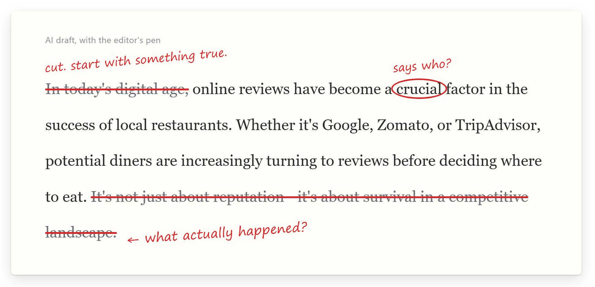

<p align="center">
  
</p>

<h1 align="center">human-writer</h1>

<p align="center">
  <em>She cuts your first paragraph. She asks who said it. She never makes anything up.</em>
</p>

<p align="center">
  <a href="https://github.com/shri-ram07/human-writer/stargazers"></a>
  <a href="https://github.com/shri-ram07/human-writer/releases/latest"></a>
  <a href="https://github.com/shri-ram07/human-writer/actions/workflows/check.yml"></a>
  
  
  <a href="LICENSE"></a>
</p>

<p align="center">
  <strong>200+ citations behind the rules &middot; 1 file for any chatbot &middot; 0 dependencies &middot; 0 made-up facts allowed</strong><br>
  <sub>The rules come from a 10,500-word research report with more than 200 citations on why AI text reads as AI, what measurably fixes it, and the law around it. The demo below is one test case, measured by the bundled <code>check.py</code>. A full with-and-without benchmark across all ten test cases is next, and the result goes here whichever way it lands. <a href="skills/human-writer/references/research-root-causes-and-fixes.md">Read the research</a> &middot; <a href="examples/">see the examples</a>.</sub>
</p>

---

You know her. Reading glasses on a cord, red pen behind one ear, editing the paper since before it had a website. You hand her 800 words. She crosses out your first paragraph, circles "crucial", writes *says who?* beside your statistic and *what actually happened?* beside your big finish, and hands it back without a word.

human-writer puts her inside your AI.

## Before / after

You ask for a blog post about restaurant reviews. Your AI opens with "In today's digital age", calls reviews "a crucial factor", announces that it's "not just about reputation—it's about survival", and signs off with "In conclusion". She has notes:

<p align="center">
  
</p>

With human-writer, the same advice comes back like this:

> The time to ask for a review is when a guest has just said something nice. If a table tells the server the mutton was the best they've had this year, that is the moment for "would you mind saying that on Google?" Asking at the bill is too late, because people are tired and already reaching for their phones to pay.

And where it didn't know the restaurant's real numbers, it said so instead of inventing them:

```text
[NEEDS: the client's current review count and the date of the newest review, so this opening is about them]
```

Both full texts, plus an essay where every number is sourced, are in [examples/](examples/).

## What changed, measured

The bundled `check.py` on that test case. One case, so read it as a demonstration, not a benchmark.

| | AI draft | human-writer |
|---|--:|--:|
| Overused AI words (crucial, landscape, fosters, ever-evolving) | 4 | **0** |
| "Moreover / Furthermore / Ultimately" sentence openers | 3 | **0** |
| "In conclusion"-style wrap-ups | 2 | **0** |
| "It's not just X, it's Y" | 1 | **0** |
| Headers in a 300-word post | 6 | **1** |
| Sentences stuck in the 8–20-word band | 80% | **50%** |
| Unnamed "studies show" claims | 1 | **0** |
| Gaps marked for your real numbers | 0 | **3** |

<details>
<summary><strong>What <code>check.py</code> printed for the AI draft</strong></summary>

```text
== 301 words, 18 sentences, 6 paragraphs, 6 headers, 3 bullet lines, 0 bold-label bullets
-- Flags
  Uniform paragraphs: all within about 11% of the mean length
  Em dashes: 4 in 301 words
  Evaluative qualifiers stacked: 4 in 301 words
  Marker words (4): crucial, landscape, fosters, ever-evolving
  Marker phrases (1): "in conclusion" (L27)
  Sentence-initial transitions (3): Moreover, Furthermore, Ultimately
  Negative parallelism (1): "It's not just about reputation—it's"
  Closers: "Ultimately, reviews are more than just ratings—the..." | "In conclusion, online reviews are a powerful tool ..."
```

</details>

<details>
<summary><strong>Every rule traces to a study</strong></summary>

| Rule | What the evidence found | Source |
|---|---|---|
| Collect first-hand material, never invent | Professional authors' text is 66% harder to rebuild from the web than model text | [Lu et al. 2025](https://arxiv.org/abs/2410.04265) |
| Propose several angles, drop the most typical | 1.6–2.1x more semantic diversity, and higher ratings from human judges | [Zhang et al. 2025](https://arxiv.org/html/2510.01171v3) |
| One repair pass on seven fault types | Closed about half the gap to edits by professional writers | [Chakrabarty, Laban & Wu 2025](https://arxiv.org/html/2409.14509v5) |
| About five samples of the author, chosen for style | Imitations passed as the author 95–97% of the time for email and news, about 20% for blogs; two samples did about as well as ten | [Wang et al. 2025](https://arxiv.org/html/2509.14543v1) |
| Keep the author's own English | AI suggestions pulled Indian writers toward American style, and Diwali essays turned generic | [Agarwal, Naaman & Vashistha 2025](https://arxiv.org/html/2409.11360v3) |
| Never let the drafting model judge its own text | Models picked GPT-4 product descriptions 89% of the time; people picked them 36% | [Laurito et al. 2025](https://pmc.ncbi.nlm.nih.gov/articles/PMC12337326/) |
| No stock names or props | Eleven stock words, Elara and lighthouses among them, turn up in 88% of model stories | [Hamilton & Mimno 2026](https://arxiv.org/abs/2605.26492) |
| No temperature tricks | One model at five temperatures was told apart 38% of the time; five different models 97% | [Sun et al. 2025](https://arxiv.org/html/2502.12150) |

More in [root-causes.md](skills/human-writer/references/root-causes.md) and the [research report](skills/human-writer/references/research-root-causes-and-fixes.md).

</details>

Not measured yet: a with-and-without benchmark across the [ten test cases](skills/human-writer/evals), and a blind panel of human judges. Both are on the list, and both go in this section when they exist.

## How it works

Before she lets the model write, she asks six questions, in order:

```
1. What actually happened?   → your facts first; she never invents one
2. What does everyone say?   → picture the obvious article, then don't write it
3. Which angle?              → five ideas, drop the predictable ones
4. Whose voice?              → five samples of yours; your English stays yours
5. One draft                 → then one red-pen pass on seven known faults
6. Says who?                 → every number sourced, nothing copied
```

Strict about the prose, stricter about the facts. She won't add a typo to look human, she won't strip a watermark, and she won't put a number in your mouth.

## Why AI writing sounds like AI (it isn't "delve")

- **Training rewards the typical.** People who rate model answers prefer familiar text, and training amplifies that. For 79% of open-ended prompts, a model's own answers are more than 80% alike, and different companies' models are 71–82% alike ([Jiang et al. 2025](https://arxiv.org/html/2510.22954); [Zhang et al. 2025](https://arxiv.org/html/2510.01171)).
- **The model has nothing first-hand.** Professional authors score 66% higher than models on how much of their text cannot be rebuilt from what is already on the web ([Lu et al. 2025](https://arxiv.org/abs/2410.04265)).
- **Surface fixes don't hold.** Paraphrased text still points back to its model about 91% of the time ([Sun et al. 2025](https://arxiv.org/html/2502.12150)). Turnitin trained its 2025 detector on humanizer output ([Plagiarism Today](https://www.plagiarismtoday.com/2025/08/27/turnitin-launches-anti-ai-humanizer-feature/)), and expert readers caught every humanized article in one study ([Russell, Karpinska & Iyyer 2025](https://arxiv.org/abs/2501.15654)).

So she doesn't touch up finished text. She changes what goes into the draft.

## Install

Less effort than reading an AI-written introduction.

### Claude Code

```
/plugin marketplace add shri-ram07/human-writer
```
```
/plugin install human-writer@human-writer
```
(Send them as two separate prompts.) Or copy the folder yourself:

```bash
git clone https://github.com/shri-ram07/human-writer
cp -r human-writer/skills/human-writer ~/.claude/skills/
```

It loads on its own for writing requests. Call it directly with `/human-writer` (or `/human-writer:human-writer` as a plugin).

### Claude apps (claude.ai, desktop)

Download `human-writer.zip` from the [latest release](https://github.com/shri-ram07/human-writer/releases/latest) and upload it under Skills in your settings (Customize > Skills, or Settings > Capabilities on older layouts). Custom skills need code execution turned on. [Anthropic's guide](https://support.claude.com/en/articles/12512180-using-skills-in-claude).

### Claude API

Upload the same folder through the [Skills API](https://platform.claude.com/docs/en/agents-and-tools/agent-skills/overview).

### Codex, Cursor, Gemini CLI, GitHub Copilot

`skills/human-writer/` is a standard [Agent Skills](https://agentskills.io) folder. Copy it into the tool's skills directory.

### ChatGPT, Gemini Gems, or any system prompt

Paste [`portable/human-writer-compact.md`](portable/human-writer-compact.md) into the instructions. It is about 5,500 characters, so it fits a custom GPT's 8,000-character box, a ChatGPT Project, a Gemini Gem, Cursor rules or `.github/copilot-instructions.md`.

That's it. She's already circling something.

## The red pen: `check.py`

```bash
python skills/human-writer/scripts/check.py draft.md                    # what she'd circle
python skills/human-writer/scripts/check.py draft.md --source notes.md  # copied runs of 8+ words
python skills/human-writer/scripts/check.py draft.md --source outputs/  # same article twice?
python skills/human-writer/scripts/check.py draft.md --json             # numbers for a pipeline
```

Python 3.10+, standard library only. It describes the writing; fix sentences, not numbers. It is not an AI detector and predicts nothing about one.

## FAQ

**Will it get my essay past Turnitin?**
No. She doesn't do disguises, and nobody can honestly promise that: detectors retrain every few months, and Claude, OpenAI and Google now watermark their text in a way no style change touches. She also won't write graded work for someone to hand in as their own. She will explain, outline from your notes and mark up your draft.

**Is this a humanizer?**
A humanizer changes the costume, and paraphrased text still points back to its model about 91% of the time. human-writer changes what goes into the draft.

**Why is there a `[NEEDS: ...]` in my post?**
Because she won't make up your numbers. Fill it in. It's usually the best line in the post.

**Can I make it stop asking me questions?**
Give it your facts up front. That's all she wanted.

**Does it work with ChatGPT, Gemini or my own model?**
Yes: paste the portable file. Building a product on it? Read [for-builders.md](skills/human-writer/references/for-builders.md) first. It covers which API controls still exist, how to keep two customers from getting the same article, and the legal rules per market.

**Which English?**
Yours. Indian English stays Indian English.

**Does it scale?**
Exactly as far as your facts do.

**Why doesn't this README say "undetectable"?**
She'd circle it.

<details>
<summary><strong>Known limits</strong></summary>

- No benchmark yet; the evidence is one demonstrated case plus published research.
- Much of the research on editing and diversity used creative writing. Marketing copy, email and LinkedIn posts are less studied.
- Copying a voice from samples works far better for email and news than for blogs.
- `check.py` is a rough mirror: it counts brand names as specifics, and punchy short sentences can trip its synonym-cycling flag.
- The lists of AI tells are dated October 2026. Models change, and so will the lists.

</details>

## Contributing

Models pick up new habits every release, and she needs to hear about them. Pull requests are welcome, especially:

- new tells with evidence: a study, or outputs from a named model and date;
- before-and-after pairs from your own writing;
- benchmark runs of the ten test cases in [`skills/human-writer/evals/`](skills/human-writer/evals).

Every rule traces to a source; keep it that way. Run `python skills/human-writer/scripts/check.py --selftest` and `python tools/validate.py` before opening a PR.

## License

[MIT](LICENSE). Short, plain, and not one crucial word in it. To cite this work, see [CITATION.cff](CITATION.cff).

Made by Shri Ram Dwivedi ([@shri-ram07](https://github.com/shri-ram07)).

## Star History

<a href="https://www.star-history.com/#shri-ram07/human-writer&Date">
 <picture>
   <source media="(prefers-color-scheme: dark)" srcset="https://api.star-history.com/svg?repos=shri-ram07/human-writer&type=Date&theme=dark" />
   <source media="(prefers-color-scheme: light)" srcset="https://api.star-history.com/svg?repos=shri-ram07/human-writer&type=Date" />
   
 </picture>
</a>
